# sbx-projects

Manage your coding agents in sandboxes through the `sbx` CLI from one terminal. Group work by project, see which agents need your attention, review changes, and jump into a conversation without losing track of your other tasks.

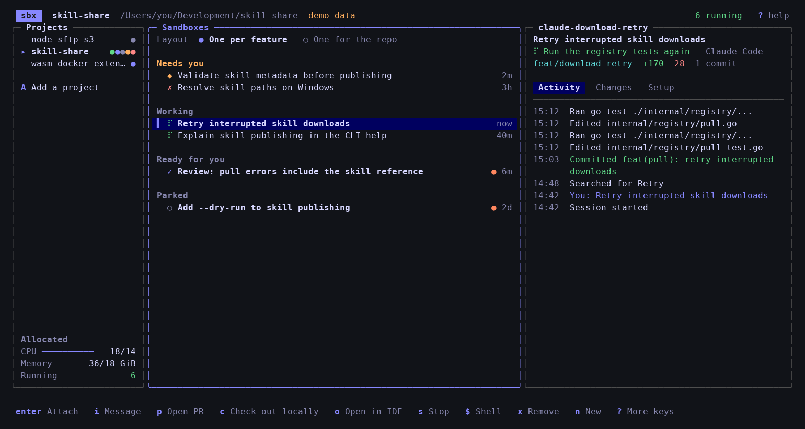

*The built-in demo: projects on the left, sandboxes in the middle, and activity for the selected sandbox on the right.*

Away from your desk? The [iPhone app](#iphone-app-and-the-api), or the same app [in any browser](#in-a-browser), shows the same sandboxes and lets you answer your agents from your phone.

## Get started

You’ll need **Go 1.26 or newer** to install or build. For real projects, install and configure the `sbx` CLI and make sure it is on your `PATH`.

Install directly with Go:

```sh
go install github.com/cmrigney/sbx-projects/cmd/sbx-projects@latest
```

Add Go’s binary directory to your `PATH` (`$(go env GOPATH)/bin` by default, or your custom `GOBIN`), then try `sbx-projects --demo`.

Or, from this repository, build and try the demo:

```sh
go build -o sbx-projects ./cmd/sbx-projects
./sbx-projects --demo
```

The demo uses built-in data and an in-memory database—no `sbx` setup is needed. Press `?` to explore the shortcuts and `q` to quit.

To use your own projects, put the binary on your `PATH`, then launch it inside a git repository:

```sh
cd /path/to/your/repo
sbx-projects
```

On the first launch, that repository is added automatically. Press `A` (Shift+A) to add more projects.

## Your first sandbox

1. Select a project and press `n` to create a sandbox.
2. Choose your agent and a branch or pull request. Use `Tab` to move between fields and the arrow keys to choose options. Expand the model, kits, and MCP summary with `Space` if you want to customize them.
3. Press `Enter` to create the sandbox and start the agent.
4. Select the sandbox and press `Enter` to attach. To return to the dashboard, press **Ctrl+B, release, then d**. The agent keeps running.
5. Back in the dashboard, press `t` to read the latest reply, or `i` to send another instruction.

A **project** is a git repository. The per-feature layout lets you run separate tasks in private clones and branches; press `m` to switch to one sandbox for the repository. Sandboxes run detached and keep running after you quit the dashboard, until you stop them.

## Shortcuts worth learning

Keys are case-sensitive. Sandbox actions apply to the selected sandbox; move out of the Projects pane with `Tab` before attaching.

### Work with an agent

| Key | Action |
|---|---|
| `n` | Create a sandbox |
| `Enter` | Attach to the agent, starting it if needed |
| **Ctrl+B, then d** | Detach from the agent and return to the dashboard |
| `i` | Send the agent a message without attaching |
| `t` | Read the agent’s last reply in full |
| `2`, then `d` | Open Changes, then view the full diff |
| `p` | Ask the agent to open a **draft** pull request |
| `o` | Open the sandbox’s private clone in your IDE over SSH |
| `c` | Fetch the private clone’s branch into your local checkout and check it out |
| `$` | Open a shell in the sandbox |
| `P` / `U` | Publish / unpublish a port (`sbx ports`) |
| `s` / `r` / `x` | Stop / resume / remove the sandbox |

An orange **●** and bold sandbox title mean there’s an unread reply. Read it with `t` or attach to clear the marker. In reply and diff views, use `j`/`k` to scroll, `Space`/`PgDown` to page down, and `Esc` to close. In a diff, `[`/`]` move between files.

### Navigate and manage projects

| Key | Action |
|---|---|
| `Tab` / `Shift+Tab` | Next / previous pane |
| `↑` / `↓` or `k` / `j` | Move through a list or scroll details |
| `←` / `→` or `h` / `l` | Switch detail tabs or panes |
| `[` / `]` | Previous / next project |
| `1` / `2` / `3` | Activity / Changes / Setup |
| `A` | Add a project |
| `D` | Forget the current project |
| `m` | Switch between per-feature and per-repository layouts |
| `K` | Set default kits for new sandboxes |
| `e` | Open the project in your local editor |
| `L` | Show the debug log |
| `?` | Show the keyboard reference |
| `q` | Quit the dashboard |

## Customize your workflow

**Default kits.** Press `K` to set the kits every new sandbox in the current project starts with. Each reference (a directory, ZIP, git URL or OCI image) must be a mixin, and is passed to `sbx run` as its own `--kit`. The New sandbox form starts with the project's kits filled in, so you can add or drop kits for one sandbox. Changing the defaults doesn't touch existing sandboxes. The Setup tab shows the kits each sandbox was created with.

**Ports.** Press `P` to forward a port on your machine to the sandbox with `sbx ports --publish`. Type it as `[[HOST_IP:]HOST_PORT:]SANDBOX_PORT[/PROTOCOL]`; a lone number such as `3000` uses the same port on both sides. Press `U` and give a host port to stop forwarding it. The Setup tab lists the published ports, and the iPhone app and web app can publish and unpublish them from the same tab. To reach a port from your phone or another device, publish it as `0.0.0.0:3000:3000` in the TUI, or pick **Local network** in the apps, and have the server in the sandbox listen on `0.0.0.0`.

**MCP servers.** The New sandbox form lists the MCP servers registered on your host (`sbx mcp ls --json`). Move along the row with ←→ and press space to pick a server; picked servers are passed to `sbx run` as `--static-mcp`. sbx fixes that set when the sandbox is created, so it can't be changed later from here. Servers that can't connect yet show why (for example "needs auth"), and the form names the command that fixes the one under the cursor. Register servers with `sbx mcp add` on your host. The form starts with the servers you last picked in the project, and the Setup tab shows the ones each sandbox was created with.

**Agent model.** When the agent is Claude Code or Codex, the New sandbox form has a Model row. Claude offers Default, Opus, Sonnet and Haiku; Codex offers Default and OpenAI's recommended Codex models. The agent starts with `--model` set to that choice, and keeps it whenever it starts or resumes; Default passes no flag. The form remembers the last model picked for each agent in the project.

**Folded rows.** The New sandbox form folds the Model, Kits and MCP servers rows into one line that sums up what the sandbox will get (for example "Opus model · 2 kits · notion"). Tab to it and press space, or click it, to show the rows.

**Open in editor.** `e` opens the project in your IDE. It uses `$SBX_PROJECTS_EDITOR` if it's set (for example `export SBX_PROJECTS_EDITOR="code -n"`). Otherwise it uses the first IDE launcher it finds on `PATH` (`cursor`, `code`, `zed`, `windsurf`, `goland`, `idea`, `subl`). On macOS it also checks for those apps in `/Applications` and opens them with `open -a`. If no IDE turns up, it uses `$VISUAL` or `$EDITOR` in the terminal, and then the system file opener.

### Command-line options and data

| Option | Purpose |
|---|---|
| `--demo` | Explore built-in demo data without `sbx` |
| `--db PATH` | Use a different projects database |
| `--sbx PATH` | Use a specific `sbx` binary |
| `--log PATH` | Write the debug log to `PATH`, or pass `off` to turn it off (also `$SBX_PROJECTS_LOG`) |
| `--log-level LEVEL` | Log `debug`, `info` (the default), `warn` or `error` and above |

Projects and sandbox metadata are stored in SQLite at `~/.local/share/sbx-projects/projects.db`, or `$XDG_DATA_HOME/sbx-projects/projects.db` when set. Demo mode does not use this database.

**Debug log.** Each run writes a new log to the `sbx-projects` folder in your temp directory, and logs older than a week are deleted. The path is printed when the dashboard starts, again if it exits with an error, and at the bottom of the `?` help. Press `L` to read the latest 500 entries without leaving the dashboard: it follows new entries as they arrive, puts each entry's details on their own lines, and `e` switches to only warnings and errors. The log records every error and status message, every `sbx` command that changes a sandbox, and the full error output of any `sbx` command that fails. With `--log-level debug` it also records the listing and status checks that run every few seconds. Scripts sent to sandboxes aren't logged, since they can contain your prompts.

## Requirements and limits

- tmux is installed with `apt-get` the first time an agent starts in a sandbox. That needs the Ubuntu archive to be reachable under your network policy.
- Sandboxes whose workspace is inside a project are adopted automatically. If an adopted sandbox's agent was started with plain `sbx run`, the TUI doesn't see it. Attaching starts a second agent in tmux.
- Changes for a stopped sandbox show what was last seen while it was running. Probing a stopped sandbox would start it.
- Open PR asks the agent to push and run `gh pr create`. This needs a GitHub token stored with `sbx secret set github`.

## How it works

Everything goes through the `sbx` CLI.

| Action | What runs |
|---|---|
| Create | `sbx run -d --name N [--clone] [--kit REF]... [--static-mcp NAME,...] AGENT PATH`, then `git checkout -b BRANCH` (or `gh pr checkout N`) in the clone, then the agent starts |
| Start agent | tmux on a private socket (`tmux -L sbxp`) inside the sandbox runs sbx's own `start-agent` launcher, so the agent keeps working with nothing attached |
| Attach (`enter`) | `sbx exec -it N tmux -u -L sbxp attach -t agent` (adding `-T RGB` when your terminal sets `COLORTERM=truecolor`). Press `ctrl-b d` to come back |
| Message (`i`), Open PR (`p`) | Your text is typed into the agent's session with `tmux send-keys` |
| Files sent with a message (apps) | `sbx cp FILE N:/tmp/sbx-attachments/ID/NAME` for each file, outside the workspace so they never show up as changes, then the message with `(Attached files: PATH, ...)` added |
| Check out locally (`c`) | On a private clone, `git fetch sandbox-N` then `git checkout -B BRANCH sandbox-N/BRANCH` in the project. sandboxd configures that remote automatically while the sandbox is running. |
| Open in IDE (`o`) | On a private clone, `cursor --remote ssh-remote+N.sbx WORKSPACE` (or `code`, or whatever `$SBXP_IDE` names), the same as Remote-SSH: Connect to Host with sbx's `N.sbx` host |
| Status, activity, changes | One `sbx exec` every few seconds per *running* sandbox reads the event log, `git log` and `git diff --numstat` against the project's default branch |
| Stop / resume / remove | `sbx stop`, `sbx run -d --name N` then the agent with `--continue`, `sbx rm -f` (after `sbx stop` if it is running) |

Sandboxes are created detached, so they keep running until you stop them.

<details>
<summary>How agent status and hooks work</summary>

**Claude Code and Codex status** comes from hooks. Each hook appends a line to `~/.sbx-projects/events.jsonl` inside the sandbox. sbx rewrites both agents' own config files, so neither is touched:

- **Claude Code** is launched with `--settings ~/.sbx-projects/claude-settings.json`, which adds hooks for `SessionStart`, `UserPromptSubmit`, `PreToolUse`, `PostToolUseFailure`, `Notification`, `Stop`, `StopFailure` and `SessionEnd`.
- **Codex** gets its hooks as a `-c hooks={…}` override plus `--dangerously-bypass-hook-trust`, which hooks from overrides need in order to run. Its events are `SessionStart`, `UserPromptSubmit`, `PreToolUse`, `PostToolUse`, `PermissionRequest`, `Stop`, `Interrupt` and `SessionEnd`. The hook reads the files out of `apply_patch` patches, and looks up a failed shell command's exit code in Codex's session log, because Codex's `PostToolUse` carries only the output. The workspace is also pre-trusted with `-c projects={…}`, as sbx does for Claude, so Codex doesn't stop at its trust prompt. Codex versions without `--dangerously-bypass-hook-trust` start without hooks.

Other agents only report whether their session is running.

</details>

## iPhone app and the API

The iPhone app keeps you in touch with your agents when you're away from the terminal. It shows the same projects and sandboxes as the TUI, kept live while the app is open, so you can see which agents need you, answer a question, read a reply in full, or start a new sandbox from your phone.

It looks like the [web app](#in-a-browser): the app icon's navy and mint, with a terminal's type for branches, times and logs, in dark or light to match your phone. Navigation, sheets, menus and controls are the iPhone's own.

<p align="center">
  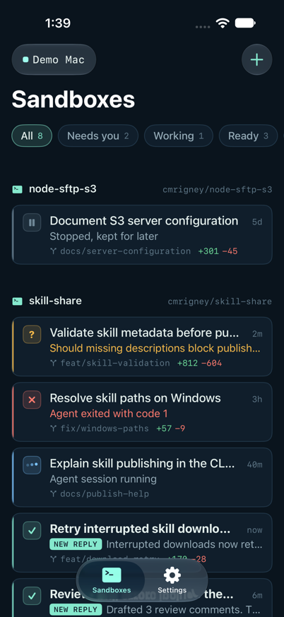
  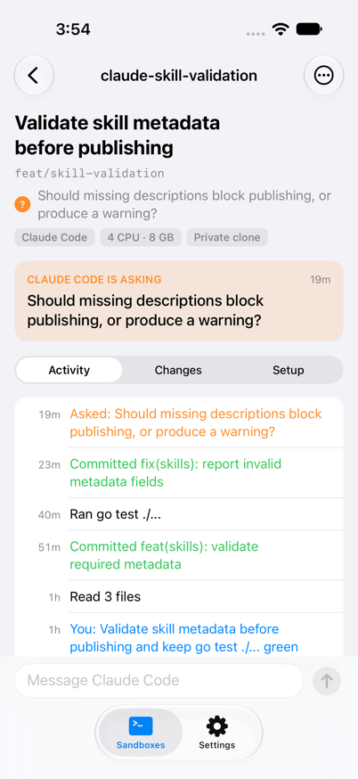
  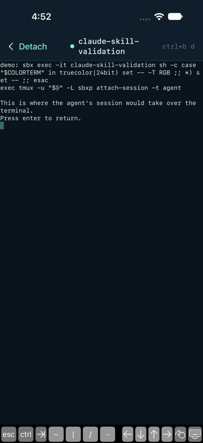
  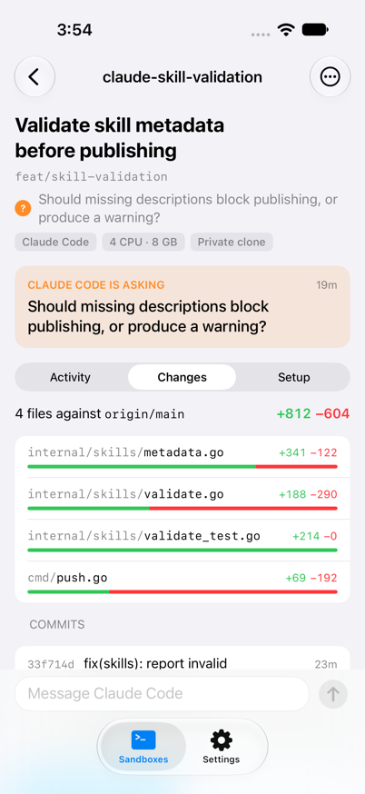
  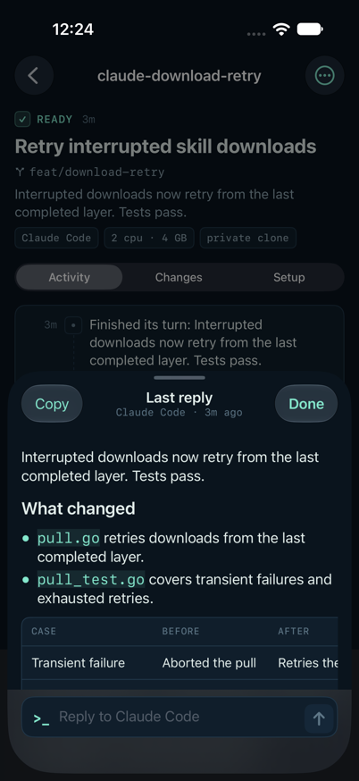
  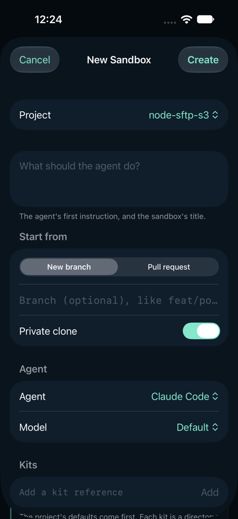
</p>

*The demo data on an iPhone in dark mode: every sandbox and its status, an agent waiting on a question, its terminal attached, its changed files, another agent's last reply, and the New sandbox form.*

From the app you can:

- Filter sandboxes by Needs you, Working and Ready, or search by title, branch or name. Parked sandboxes are hidden until you choose Parked.
- Read an agent's activity, changed files and commits, and the full diff file by file.
- Send the agent a message, or reply to its last answer. The paperclip attaches photos or files; tap one to mention it in the message.
- Attach to the agent's terminal, as `Enter` does in the TUI, with a key bar for Ctrl, Esc, Tab and the arrows. **Detach** or **Ctrl+B, then d** returns to the sandbox; the agent keeps running.
- Open a draft pull request, check out the branch on your Mac, and stop, resume or remove a sandbox.
- Create a sandbox with the same choices as the New sandbox form.
- Pair with more than one Mac and switch between them from the Mac's name at the top of the list.

To try it, build the app from [`ios/`](ios/README.md) in Xcode, then run the API on your Mac and scan the QR code it shows:

```sh
./sbx-projects api --demo --pair
```

Your phone and Mac need to be on the same network. Drop `--demo` to use your real projects.

### In a browser

The same server also serves a web app that does everything the iPhone app does, for Android phones, iPads and other computers. Open the `https://…/#/pair?code=…` link `--pair` prints, or open the Mac's address and type the code. Your browser warns about the self-signed certificate the first time; accept it to continue. Each browser pairs as its own device, such as "Safari on iPhone", and `api devices rm` signs it out.

Messages in the web app can carry files too: choose them with the paperclip, paste a screenshot, or drop files on the message box. Click a file to put its name in the message.

The web app can also **attach** to an agent, as `Enter` does in the TUI: **Attach** on a sandbox (or `Enter` on a keyboard) opens its terminal in the page, resuming the sandbox or starting the agent first when needed. On a phone, a key bar adds Ctrl, Esc, Tab and the arrows. **Detach** or **Ctrl+B, then d** returns to the sandbox; the agent keeps running.

It has the same look as the iPhone app, taken from the app icon: navy and mint, with a terminal's type for branches, times and logs, in dark or light to match your system. On a phone it shows one screen at a time:

<p align="center">
  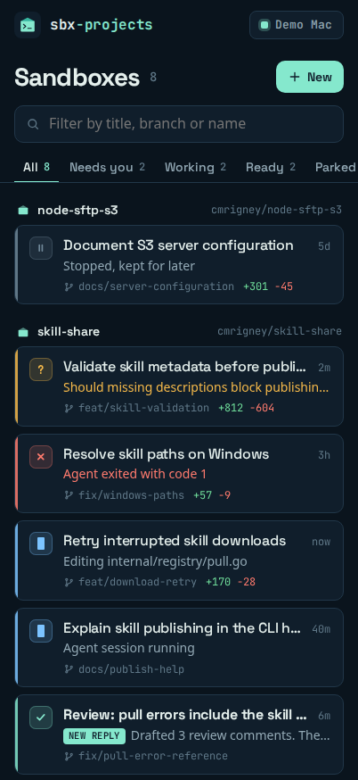
  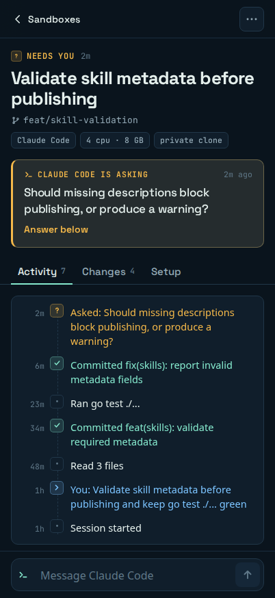
  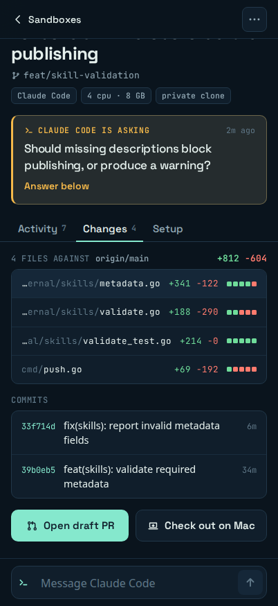
  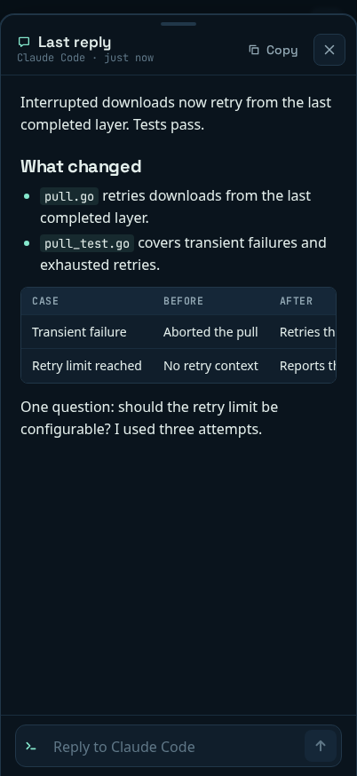
</p>

On a wider screen the list and the open sandbox sit side by side, and the TUI's keys work: `n` new sandbox, `/` search, `1`–`3` tabs, `i` message, `t` last reply, `p` draft PR, `c` check out, `s`/`r` stop/resume and `x` remove.

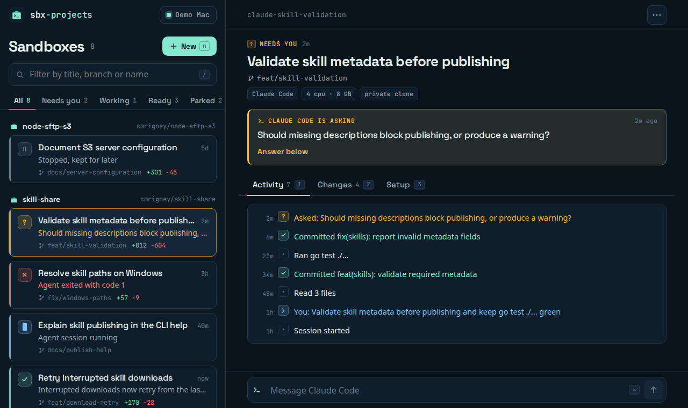

*The demo data in a browser: every sandbox and its status, an agent waiting on a question, its changed files and commits, another agent's last reply, and the two-pane layout on a wide screen.*

The app lives in [`web/`](web/) (React and Vite) and is built into the binary. Build it before building `sbx-projects`; without it, the server answers `/` with how to build it:

```sh
task web      # npm ci and build into internal/webui/dist
task build
task web:dev  # hot reload, proxying /v1 to sbx-projects api on :7443
```

### The API

`sbx-projects api` serves the same projects and sandboxes over HTTPS on your local network, for the iOS app in [`ios/`](ios/README.md) and the web app in [`web/`](web/). It runs the TUI's list-and-probe loop without a terminal and goes through the same `internal/core` actions.

```sh
./sbx-projects api --pair          # serve, and show a code to pair a phone
./sbx-projects api --demo --pair   # the same against demo data
./sbx-projects api devices         # list paired phones
./sbx-projects api devices rm NAME # sign one out
```

Flags: `--listen` (default `:7443`), `--name` (what the app calls this Mac, the host name by default), `--pair`, and the TUI's `--db`, `--sbx`, `--demo`, `--log` and `--log-level`. Pairing opens by itself while no phone is paired. The server writes its own debug log, printed with its addresses, which also records the HTTP server's errors; connections from clients that reject the certificate are only logged at `--log-level debug`.

- **Pairing.** The terminal shows a QR code and an 8-character code, valid once for 5 minutes. The QR code carries the Mac's addresses and its certificate's fingerprint. Five wrong codes close pairing.
- **TLS.** The first run makes a self-signed certificate in `~/.local/share/sbx-projects/api/`. Phones pin its SHA-256 fingerprint, so it is never renewed; deleting it means pairing again.
- **Tokens.** Each phone gets its own token. Only a hash is kept, in `api/devices.json`. `devices rm` takes effect without a restart.
- **Finding the Mac.** It is advertised over Bonjour as `_sbxp._tcp` (with `dns-sd` on macOS, `avahi-publish-service` on Linux), so the app finds it again when its address changes.
- **Live updates.** `GET /v1/events` is a server-sent event stream: a snapshot of everything, then each sandbox whose status changes, and how each action ends.

The TUI and the API can run at once. Each probes running sandboxes on its own, and neither overwrites a sandbox the other created. A reply read on the phone stays marked unread in a running TUI until it restarts.

| Endpoint | What it does |
|---|---|
| `GET /v1/server`, `POST /v1/pair` | Who this is, and trading a pairing code for a token (no token needed) |
| `GET /v1/events` | The change stream |
| `GET /v1/projects`, `GET /v1/sandboxes` | Projects, and every sandbox with its status |
| `GET /v1/sandboxes/{name}` | One sandbox with its activity, changed files and commits |
| `GET …/reply`, `POST …/seen` | The last reply as markdown, and clearing its unread mark |
| `GET …/diff` | The full diff, split by file |
| `POST …/messages` `{"text"}` | Type a message into the agent's session. As `multipart/form-data`, a `text` field and `file` parts (up to 20 files, 100 MB in all) are copied into the sandbox first, and the message gets their paths there |
| `POST …/pr`, `…/stop`, `…/resume`, `…/checkout`; `DELETE /v1/sandboxes/{name}` | The TUI's actions. They answer at once with the sandbox busy; the outcome arrives as an `action` event |
| `POST /v1/sandboxes` | Create a sandbox, as the New sandbox form does |
| `GET /v1/options?project=ID` | Agents, models, MCP servers and the project's defaults for that form |
